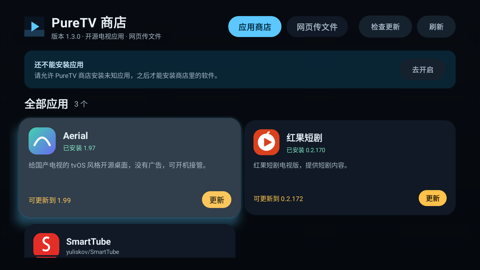
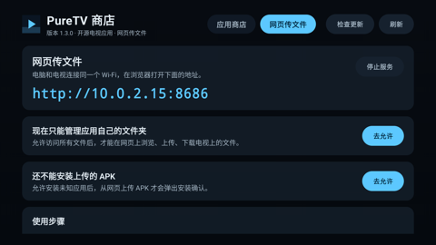

# PureTV 商店

在电视上浏览、安装和更新常用的开源电视应用，并用电脑浏览器给电视传文件。

## 功能

- **应用商店**：读取本仓库中的软件清单，从各软件的 GitHub Release 获取最新版本；显示是否已安装、
  是否有新版本，并下载安装。有更新的应用排在前面，并用黄色“更新”标出。首次内置红果短剧、
  SmartTube 和 Aerial 桌面。
- **网页传文件**：电视上启动服务后，在同一 Wi-Fi 的电脑浏览器打开 `http://电视IP:8686`，
  可上传 APK 并直接安装，也可浏览、上传、下载、重命名和删除电视上的文件。
- **自动检查更新**：打开应用时自动刷新商店列表和已装版本，也可手动刷新。
- **系统安装确认**：所有安装都经过电视系统确认，不能静默安装。
- **应用内更新**：启动时自动检查商店新版本，也可手动检查；下载后交给电视系统安装器。

## 界面预览

<table>
  <tr>
    <td width="50%" valign="top"></td>
    <td width="50%" valign="top"></td>
  </tr>
  <tr>
    <td align="center">应用商店</td>
    <td align="center">网页传文件</td>
  </tr>
</table>

## 安装

1. 在 [Releases](https://github.com/JamesWDGu/PureTVStore/releases/latest) 下载
   `PureTVStore-<版本>.apk`，复制到电视或电视盒子安装。
2. 也可以使用 [PureTV 手机助手](https://github.com/JamesWDGu/PureTVMobileHelper)，在
   “设备控制面板 → 安装 PureTV 商店”中一键安装到已连接的电视。
3. 电视上首次安装需要允许“安装未知应用”。应用更新也由系统安装器确认。

## 使用

### 应用商店

- 打开应用即显示清单中的软件；已安装的会标出版本，有新版本时可点击卡片更新。
- 点击“刷新”重新读取清单和最新版本。
- 第一次安装商店中的软件前，需要允许 PureTV 商店“安装未知应用”。

### 网页传文件

1. 切到“网页传文件”，确认服务已开启，记下显示的地址，例如 `http://192.168.1.50:8686`。
2. 电脑和电视连接同一个 Wi-Fi，在浏览器打开该地址。
3. 上传 APK：选择文件后自动上传并开始安装；电视上会弹出系统安装确认。
4. 文件管理：浏览目录、进入文件夹、上传、下载、重命名、删除、新建文件夹。默认只能访问应用
   自己的文件夹；在电视上允许“访问所有文件”后，才能管理电视共享存储中的文件。
5. 不需要时可点“停止服务”。服务仅在同一局域网内可用。

## 添加或修改商店软件

编辑仓库中的 [`store/apps.json`](store/apps.json)，提交到 `main` 后，电视刷新即可看到变化：

```json
{
  "apps": [
    {
      "id": "hongguo",
      "name": "红果短剧",
      "packageName": "rocks.aston.hongguotv",
      "repo": "aston314/hongguo-tv-releases",
      "description": "红果短剧电视版，提供短剧内容。",
      "assetPattern": "^hongguo-tv-[0-9].*\\.apk$",
      "iconUrl": "https://raw.githubusercontent.com/JamesWDGu/PureTVStore/main/store/icons/hongguo.png"
    }
  ]
}
```

- `packageName` 用于判断是否已安装以及版本高低。
- `repo` 是 GitHub 仓库，必须发布正式 Release。
- `assetPattern` 是从 Release 附件中挑选 APK 的正则；省略时选择第一个 `.apk`。
- `iconUrl` 可省略。已安装的应用直接读取电视上的真实图标；未安装时从该地址下载并缓存，
  省略或加载失败则显示首字母色块。图标建议为正方形 PNG。
- 同一个 Release 有多个架构安装包时，会按电视 CPU 自动选择：优先 `arm64-v8a`（64 位 ARM）、
  `armeabi-v7a`（32 位 ARM）、`x86_64`、`x86`，只有没有匹配架构时才使用 universal/通用包；
  没有可用包会在应用行显示原因。
- 如果电视暂时读不到清单，会使用上次成功读取的清单；再失败则使用应用内置的清单。

## 环境要求

- 电视或电视盒子：Android 6.0（API 23）及以上，支持横屏遥控操作。
- 编译：JDK 25、Android SDK Platform 37、Build Tools 36 及以上。

## 已知限制

- 只支持 GitHub Release 中的单个 APK，不支持分卷、XAPK、APKS 或需要额外数据的安装包。
- “已安装/可更新”按包名和版本号判断；某个软件改了包名会显示为另一个应用。
- 网页服务只提供 HTTP，仅适合可信的家庭局域网；不要在公共 Wi-Fi 上开启。
- 网页上传的 APK 必须由电视上的系统安装器确认；如果电视禁止安装未知应用，会提示先授权。
- 未授予“访问所有文件”时，网页只能管理应用自己的文件夹。
- 部分电视的系统安装器会限制后台安装或需要额外确认，以电视实际提示为准。

## 隐私

- 不收集、不上传使用数据，不包含统计、崩溃上报或广告。
- 联网仅用于读取本仓库的软件清单、读取 GitHub Release 信息、下载用户选择安装的软件。
- 网页服务只在用户开启期间监听局域网端口，上传的文件保存在电视本地。
- 设备连接信息、文件路径和上传内容不会发送到其他服务器。

## 开发

```bash
./gradlew :app:assembleDebug
./gradlew :app:testDebugUnitTest
./gradlew :app:lintDebug
./gradlew :app:assembleRelease
```

构建与发布约定、代码结构、数据流和必须保持的行为见 [AGENTS.md](AGENTS.md)。版本号在
`gradle.properties` 的 `storeVersionName` 修改，`versionCode` 按 `MAJOR×10000 + MINOR×100 + PATCH`
推导；发布前更新 [CHANGELOG.md](CHANGELOG.md)。
